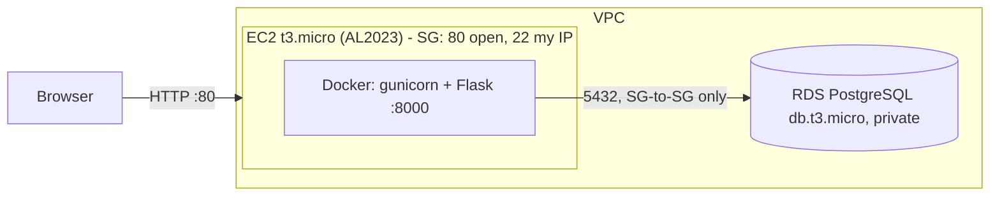

# To-Do List on AWS

Flask app + PostgreSQL (Amazon RDS), running in Docker on an Amazon Linux 2023 EC2 instance.

## Architecture

Request path: browser -> EC2 public IP:80 -> Docker port map -> gunicorn/Flask -> RDS -> response back the same way.

## Run locally
    docker compose up --build   # http://localhost:8000

## Deploy to AWS
1. **Billing alert**: Billing > Budgets > create a $1 budget with email alert.
2. **RDS**: PostgreSQL, free-tier template, db.t3.micro, 20 GB, *Public access: No*, new SG `todo-rds-sg`, initial DB `todos`.
3. **EC2**: Amazon Linux 2023, t3.micro (or t2.micro), SG `todo-web-sg`: inbound 80 from 0.0.0.0/0, 22 from *your IP only*. Attach an IAM instance profile with the `AmazonSSMManagedInstanceCore` policy (needed for auto-deploy).
4. **RDS SG**: inbound 5432 with source = `todo-web-sg` (not a CIDR).
5. SSH in and install Docker:

       sudo dnf install -y docker git
       sudo systemctl enable --now docker
       sudo usermod -aG docker ec2-user && newgrp docker

6. Clone, create `.env` on the server (never committed), run:

       git clone https://github.com/AHLegendary/EC2DOList.git app && cd app
       cp .env.example .env && nano .env      # fill in RDS endpoint + password
       docker build -t todo .
       docker run -d --name todo --restart unless-stopped -p 80:8000 --env-file .env todo

7. Open `http://<ec2-public-ip>/` and `/health`.

## Environment variables
The app reads its database settings from the environment. Nothing is hardcoded.

| Variable | Required | Default | Meaning |
|---|---|---|---|
| `DB_HOST` | yes | - | Database hostname (`db` in compose, RDS endpoint on EC2) |
| `DB_USER` | yes | - | Database user |
| `DB_PASSWORD` | yes | - | Database password |
| `DB_NAME` | no | `todos` | Database name |
| `DB_PORT` | no | `5432` | Database port |

Where they come from: `docker-compose.yml` locally and in CI, and a `.env` file on the EC2 server (never committed; see `.env.example`).

GitHub repository **variables** (Settings > Secrets and variables > Actions > Variables) used by the deploy workflow. None are secret, and no AWS keys are stored anywhere:

| Variable | Example |
|---|---|
| `AWS_ROLE_ARN` | `arn:aws:iam::123456789012:role/github-deploy` |
| `AWS_REGION` | `us-west-2` |
| `EC2_INSTANCE_ID` | `i-0abc123def4567890` |

## Redeploy
Automatic via the Deploy workflow. To do it by hand:

    git pull && docker build -t todo . && docker rm -f todo && docker run -d --name todo --restart unless-stopped -p 80:8000 --env-file .env todo

## Auto-deploy (GitHub Actions + SSM)
`.github/workflows/deploy.yml` runs after CI passes on `main`. It signs in to AWS with GitHub OIDC (short-lived credentials, no stored keys) and uses AWS Systems Manager to run the redeploy on the instance, so port 22 stays closed to the internet. Until `AWS_ROLE_ARN` is set, the job skips.

One-time setup:
1. IAM > Identity providers > add `token.actions.githubusercontent.com` (audience `sts.amazonaws.com`).
2. Create an IAM role `github-deploy` with this trust policy (replace `<ACCOUNT_ID>`):

       {
         "Version": "2012-10-17",
         "Statement": [{
           "Effect": "Allow",
           "Principal": {"Federated": "arn:aws:iam::<ACCOUNT_ID>:oidc-provider/token.actions.githubusercontent.com"},
           "Action": "sts:AssumeRoleWithWebIdentity",
           "Condition": {
             "StringEquals": {"token.actions.githubusercontent.com:aud": "sts.amazonaws.com"},
             "StringLike": {"token.actions.githubusercontent.com:sub": "repo:AHLegendary/EC2DOList:ref:refs/heads/main"}
           }
         }]
       }

3. Attach this permissions policy to the role (replace the placeholders):

       {
         "Version": "2012-10-17",
         "Statement": [
           {"Effect": "Allow", "Action": "ssm:SendCommand",
            "Resource": [
              "arn:aws:ec2:<REGION>:<ACCOUNT_ID>:instance/<INSTANCE_ID>",
              "arn:aws:ssm:<REGION>::document/AWS-RunShellScript"]},
           {"Effect": "Allow",
            "Action": ["ssm:GetCommandInvocation", "ssm:ListCommandInvocations"],
            "Resource": "*"}
         ]
       }

4. Add the three GitHub variables from the table above.
5. Actions tab > Deploy > Run workflow to test it.

The server clones over HTTPS, so the repo must be public (or use a deploy key) for `git pull` to work.

## Why is the frontend inside `app.py`?
A browser can't talk to a database directly (Postgres isn't meant to be exposed to the internet), so there are always three pieces:

    Browser (HTML) -> Server code (app.py) -> Database (Postgres)

`app.py` is the middle piece. It also serves the HTML page (the `PAGE` string), so the whole app is one container with no build step. I chose that because this assignment is about deployment, not app complexity.

The alternative is a separate React frontend calling a JSON API in Flask. It works, but adds a build step and a second thing to serve and explain, so I skipped it. It would be a natural next step if the app grew.

## CI
`.github/workflows/ci.yml` runs on every push to `main` and on pull requests. It builds the Docker image, starts the app with a test Postgres, waits for `/health`, then adds a to-do and reads it back. A failing check means a broken build never reaches the server, because the Deploy workflow only runs after CI succeeds.

## Design choices / tradeoffs
- **EC2 + Docker, no Lambda**: the assignment requires EC2; Lambda would add API Gateway + VPC networking with no benefit here.
- **RDS over self-hosted DB**: managed backups/patching; tradeoff is free-tier limits and cost after it.
- **Amazon Linux 2023**: AWS-maintained, SSM-ready; considered Ubuntu (more familiar, similar).
- **Security**: no secrets in repo, RDS not public, SG-to-SG rule, SSH limited to my IP.
- **Before real customers**: HTTPS (ALB + ACM), Multi-AZ RDS, Secrets Manager, CI/CD, CloudWatch alarms, private subnets.
